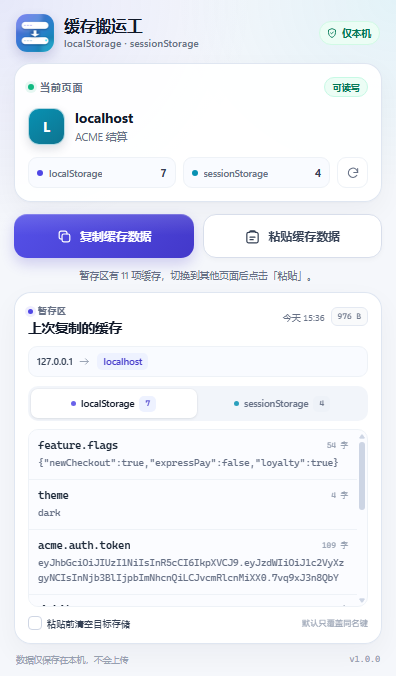
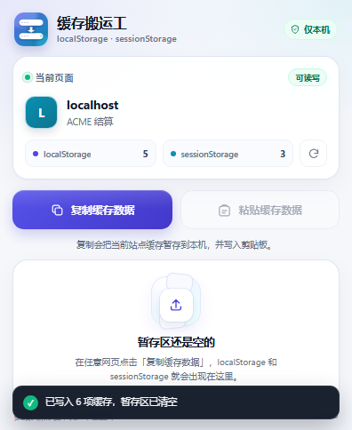

# 缓存搬运工 · Storage Porter

一个轻量的 Chrome / Edge 扩展：把当前网站的 `localStorage` 与 `sessionStorage` 一键暂存，再粘贴到另一个页面。



## 功能

- **一键复制**：读取当前域名下的全部 `localStorage` 和 `sessionStorage`，暂存在扩展本机存储中，同时把一份 JSON 写入系统剪贴板。
- **即时展示**：浮窗内按存储类型展示键名、内容、字符数和缓存大小；长内容可点击展开。
- **跨页面粘贴**：切换到另一个页面后，打开浮窗即可把上一次复制的内容写回对应存储。
- **覆盖或清空**：默认只覆盖同名键、保留目标页面已有的其他键；勾选「粘贴前清空目标存储」可完整恢复快照。
- **粘贴后自动清理**：成功写入后会清空暂存区；若写入失败则保留快照，方便重试。
- **跨域可用**：快照来自哪个域名都可以粘贴到当前页面，来源与目标域名会在浮窗中明确显示。
- **纯本地**：没有网络请求，缓存快照只保存在本机扩展存储中。

## 安装

1. 打开 Chrome，进入 `chrome://extensions`（Edge 为 `edge://extensions`）。
2. 打开右上角的 **开发者模式**。
3. 点击 **加载已解压的扩展程序**，选择本项目文件夹 `storage-manage`。
4. 在工具栏的扩展菜单中把「缓存搬运工」固定到工具栏，方便随时点击。

不需要构建，也没有 npm 依赖。

## 使用

1. 打开要复制缓存的网页，点击工具栏里的扩展图标。
2. 点击 **复制缓存数据**。浮窗会自动滚动到暂存区，展示刚刚复制的内容。
3. 切换到目标页面，再次点击扩展图标。
4. 按需勾选 **粘贴前清空目标存储**，然后点击 **粘贴缓存数据**。
5. 浮窗会显示写入数量；成功后暂存区会自动清空。若遇到容量限制或页面限制，会在对应存储或页面提示中说明原因，并保留快照以便重试。

复制按钮会先保存到扩展本机存储，再尝试写入系统剪贴板。即使剪贴板不可用，暂存与跨页面粘贴仍然可以正常使用。

粘贴成功后，暂存区会自动清空，避免缓存继续留在扩展里；如果只有部分数据写入失败，快照会保留下来供你重试。



## 数据行为

| 操作 | 行为 |
| --- | --- |
| 复制 | 读取当前标签页顶层文档的 `localStorage` 和 `sessionStorage`，保存为一份快照；只保留最近一次复制 |
| 默认粘贴 | 逐项 `setItem`，覆盖目标页面的同名键，保留其他键 |
| 清空后粘贴 | 先清空目标页面的 `localStorage` 与 `sessionStorage`，再写入快照中的全部键 |
| 粘贴成功 | 自动清除扩展内的暂存快照，粘贴按钮变为不可用 |
| 粘贴失败 | 保留暂存快照，便于修复容量或页面权限问题后重试 |
| 关闭浏览器 | 未粘贴的快照仍保存在本机；再次打开扩展依旧可用 |

`sessionStorage` 本身按标签页与来源隔离。把快照粘贴到另一个页面时，等于在新标签页的 `sessionStorage` 中重新建立这些键值，这是浏览器的正常行为。

## 权限说明

| 权限 | 用途 |
| --- | --- |
| `activeTab` | 只在你点击扩展图标后，临时访问当前标签页 |
| `scripting` | 在当前页面读写两类 Web Storage |
| `storage` / `unlimitedStorage` | 在本机保存最近一次缓存快照 |
| `clipboardWrite` | 把复制的内容同时写入系统剪贴板 |

扩展没有申请 `<all_urls>` 等常驻站点权限，也不会发起任何网络请求。

## 使用限制

以下页面受浏览器保护，扩展无法注入脚本，浮窗会显示「受限」：

- `chrome://`、`edge://`、`about:` 等浏览器内部页面
- Chrome 应用商店 / Edge 加载项商店
- 浏览器内置 PDF 阅读器等特殊页面

如果要处理本地文件（`file://`），需要在扩展详情页打开 **允许访问文件网址**。

## 项目结构

```text
storage-manage/
├─ manifest.json            # Manifest V3 配置
├─ popup.html               # 浮窗结构
├─ popup.css                # 浮窗样式
├─ popup.js                 # 复制、暂存、粘贴与状态逻辑
├─ icons/
│  ├─ icon16.png
│  ├─ icon32.png
│  ├─ icon48.png
│  └─ icon128.png
├─ docs/                     # 界面预览
└─ tools/generate_icons.py   # 图标生成脚本
```

## 开发

修改 `popup.html`、`popup.css` 或 `popup.js` 后，在 `chrome://extensions` 中点击扩展卡片上的刷新按钮，再重新打开浮窗即可生效。

图标由 Pillow 生成：

```powershell
python tools/generate_icons.py
```

## 隐私

缓存快照仅写入 `chrome.storage.local`，不会上传到服务器；粘贴成功后会自动清除。复制操作额外写入剪贴板的内容由你的系统剪贴板管理。请注意，缓存中可能包含登录令牌等敏感信息；复制和粘贴完成后，可再次复制新数据覆盖旧快照，或在扩展管理页清除扩展数据。
